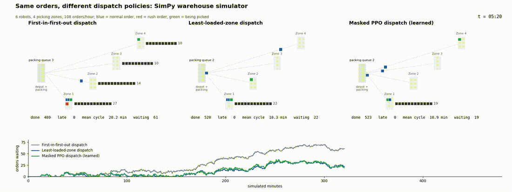
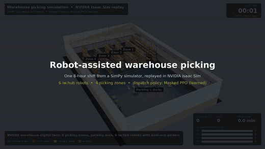

# warehouse-sim-rl

A small **discrete-event simulator of a robot-assisted picking warehouse** (SimPy), wrapped as a
**Gymnasium** environment for learning dispatch policies, with **Optuna** calibration of the simulator
against observed site data.

The point of the project is the full loop an applied simulation/RL team needs:
simulate → calibrate to reality → learn a policy → benchmark it honestly against heuristics.



*One 8-hour shift, identical orders (common random numbers), two heuristics and the learned masked-PPO policy. Full 60-second
video: [media/demo.mp4](media/demo.mp4) — regenerate with `python render_video.py`.*

### 3D replay in NVIDIA Isaac Sim

[](media/demo_isaac.mp4)

*One 8-hour shift under the learned masked-PPO dispatch policy, replayed in **NVIDIA Isaac Sim 6.2** with iw.hub
warehouse robots and cardboard-box assets from NVIDIA's public asset library, rendered with the RTX renderer through
Replicator (60 seconds at 1080p: [media/demo_isaac.mp4](media/demo_isaac.mp4); the preview above runs at 3x speed).
Every frame is computed from the SimPy event trace and robots are moved kinematically, so the video shows exactly what
the simulator decided; distances are compressed so the whole floor fits one view.*

```bash
python tools/export_trace.py --policy maskable_ppo_dispatch.zip --minutes 480 --out media/trace.json
# on a Linux RTX GPU with the nvcr.io/nvidia/isaac-sim:6.2.0 container
/isaac-sim/python.sh isaac/replay_isaac.py --trace media/trace.json --out frames/ --seconds 60
/isaac-sim/python.sh isaac/overlay.py frames/
ffmpeg -framerate 30 -i frames/%04d.png -c:v libx264 -pix_fmt yuv420p media/demo_isaac.mp4
```

Rendered headless on one RTX 4090 rented on Vast.ai (about 0.5 s per frame).

## Model

| Warehouse element | SimPy construct |
|---|---|
| Order backlog (orders wait to be assigned) | `simpy.FilterStore` |
| Fleet of autonomous mobile robots | `simpy.Resource` (capacity = fleet size) |
| Human pickers, one pool per zone | `simpy.Resource` per zone |
| Packing station, rush orders served first | `simpy.PriorityResource` |

An order arrives (Poisson), waits in the backlog, is assigned to a free robot by a **dispatch policy**,
the robot drives to the order's zone (travel time grows with the number of robots moving — a simple
congestion model), waits for a picker, the lines are picked, the robot returns, and the tote queues
for packing. Rush orders have a 20-minute service level, normal orders 60 minutes.

Demand and service times use **separate random streams** (common random numbers), so different policies
and calibration candidates are compared on exactly the same orders.

## Quick start

```bash
python -m venv .venv && source .venv/bin/activate
pip install -r requirements.txt
pytest -q                          # determinism, conservation, capacity, priority, Gymnasium API
python calibrate.py --trials 60    # Optuna: fit simulator parameters to observed cycle times
python train.py --masked --timesteps 500000  # MaskablePPO vs heuristic baselines on 20 held-out shifts

# optional: track every run with MLflow, then browse them
python calibrate.py --trials 60 --mlflow
python train.py --masked --timesteps 500000 --mlflow
mlflow ui                          # http://127.0.0.1:5000
```

## Components

* `warehouse_sim/sim.py` — the SimPy model (`WarehouseSim`, `SimConfig`).
* `warehouse_sim/policies.py` — heuristic baselines: first-in-first-out, rush-first, least-loaded zone.
* `warehouse_sim/env.py` — `WarehouseDispatchEnv`: one step = one dispatch decision; observation =
  per-zone backlog, rush backlog, oldest-order age and picker load; reward = on-time completions minus
  late penalties (rush weighted double). Exposes `action_masks()` for masked policies.
* `calibrate.py` — simulation-to-reality calibration. A hidden "real site" produces noisy cycle-time logs;
  Optuna (TPE) searches pick time, robot speed and congestion to minimise the Wasserstein distance between
  simulated and observed cycle-time distributions plus a throughput term, then checks the result on
  held-out seeds.
* `train.py` — Stable-Baselines3 PPO and evaluation against all baselines on held-out seeds (mean, std).
* `warehouse_sim/tracking.py` — optional **MLflow** experiment tracking (`--mlflow`). Calibration logs every Optuna
  trial (gap and candidate parameters per step) and the final report; training logs hyperparameters, the model,
  results on held-out shifts, and one nested run per heuristic baseline so they compare side by side in `mlflow ui`.
* `render_video.py` — side-by-side animation of policies on the same shift (add `--model maskable_ppo_dispatch.zip`
  for a learned-policy panel).
* `tools/export_trace.py` + `isaac/replay_isaac.py` + `isaac/overlay.py` — export one simulated shift as an event trace
  and replay it in NVIDIA Isaac Sim (USD stage, iw.hub robots, RTX rendering through Replicator, driven frame by frame
  from the trace), with the clock and KPIs drawn on afterwards.

## Results (default configuration, 1.8 orders/minute, 20 held-out shifts)

| Policy | Orders/hour | Mean cycle time (min) | 95th-percentile cycle (min) | Late rate | Rush late rate |
|---|---|---|---|---|---|
| First-in-first-out | 93.7 | 32.5 | 69.4 | 20.5% | 1.3% |
| Rush-first | 93.8 | 32.7 | 69.3 | 16.8% | 0.0% |
| Least-loaded zone | 101.6 | 17.5 | 47.5 | 2.8% | 0.0% |
| **Masked PPO** (500k steps) | 95.1 | 19.2 | 49.8 | **2.6%** | 2.2% |

`python train.py --masked --timesteps 500000`. Masking (`sb3_contrib.MaskablePPO` with `action_masks()`)
removed the invalid empty-zone choices of plain PPO (about 120 per shift) and brought the learned policy level
with the best heuristic on overall late rate, from scratch and without hand-written rules. It does not yet beat
it on throughput or on rush orders: the reward weights rush lateness only 2x, and the observation has no
explicit picker-queue forecast. Those are the next experiments.

Calibration (40 trials): distribution gap 39.2 → 4.3 minutes on held-out seeds. Pick time and robot
speed are recovered reasonably well; **congestion is poorly identified** from cycle times alone
(it trades off against speed) — a reminder to check identifiability, not just goodness of fit.

## Roadmap

- [x] Action masking (`sb3_contrib.MaskablePPO` with `action_masks()`)
- [ ] Reward shaping for rush orders; picker-queue features in the observation
- [ ] Robot battery and charging stations (`simpy.Resource` with charging processes)
- [ ] Aisle congestion as a capacity-limited resource instead of a travel-time factor
- [ ] Calibrate against more statistics (per-zone cycle times, queue lengths) to identify congestion
- [x] Experiment tracking with MLflow
- [ ] Sensitivity analysis over fleet size and arrival rate

## Licence

MIT
